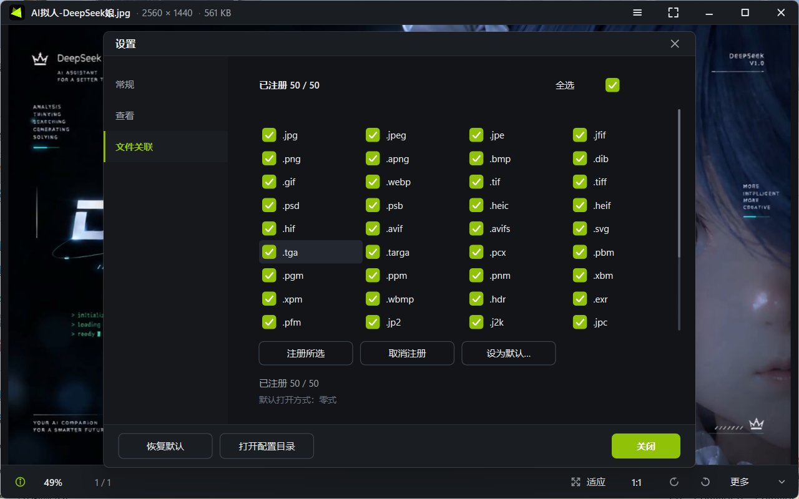

# 零式 · Zore

**Windows 原生看图软件**：C++23 + Win32 + D3D11/D2D，启动快、界面干净、不联网。

<p align="center">
  
  
</p>

## 特性

- **速度**：先出预览档（约 80 ms）再升级显示档，同目录切换复用缓存；两段式加载不闪白
- **支持格式**：JPEG / PNG / APNG / GIF / WebP / TIFF / BMP / ICO / PSD / HEIC / AVIF / SVG / TGA / PCX / PNM / XBM / XPM / WBMP / HDR / EXR / PFM / JP2 / JXR / MNG，以及 **RAW**（LibRaw：CR2/CR3/NEF/ARW/RAF/ORF/RW2/PEF/SRW/DNG…）

- **UI**：无边框窗口、深浅色、中英双语、DPI 感知、智能缩略图（渐隐/常显/关闭）、拖拽排序、记忆位置
- **看图该有的都有**：适应/1:1/自由缩放、旋转、全屏、鸟瞰图、信息面板（EXIF）、逐帧动画、目录监视与文件夹穿透、资源管理器式对话框 + 质量滑条 + 体积预估；
- **系统集成**：Shell 缩略图处理器、右键「用零式打开 / 设为壁纸 / 复制图像」、单实例、便携模式
- **干净**：0 网络请求、0 遥测；GPL-3.0 开源 无图片管理器 无幻灯片

## 下载

| 方式 | 说明 |
| --- | --- |
| **安装版** `dist\Zore-0.3.0-setup.exe` | 双击安装：选语言 → 接受许可 → 选目录 → 勾选关联/默认看图 |
| **便携版** `zoreview.exe` + `ZoreViewThumb.dll` | 放同一目录，加 `--portable` 启动，设置与缓存留在 exe 旁边 |

卸载会连同安装目录、`HKCU\Software\ZoreView`、`%LOCALAPPDATA%\ZoreView` 一起删干净。

## 构建

需要 Visual Studio 2022+（MSVC）与 CMake 3.20+。

```powershell
powershell -ExecutionPolicy Bypass -File tools\build.ps1 -Config Release
# 产物：build\Release\zoreview.exe
```

依赖已随仓库提供（`third_party/`：FreeImage、LibRaw、libjpeg、zlib），无需额外下载。
打包安装器：`tools\make_installer.ps1`（需要 Inno Setup 6）。

## 开发方式

本项目由 AI 与人工协作完成，如实说明：

| 环节 | 分工 |
| --- | --- |
| **代码实现** | **AI 实现**（C++/CMake/脚本基本由大语言模型生成） |
| **逻辑设计** | **AI 辅助**：AI 提方案与实现，**人为调整**——取舍、边界条件、踩坑修正由人决定 |
| **UI 设计** | **人为调整**：布局、配色、间距、图标与交互细节由人定稿 |

产品的判断（要什么功能、体验该是什么样、什么算"对"）由人负责；AI 负责把判断写成代码。

## 许可

[GPL-3.0](LICENSE)。第三方组件许可见 [NOTICE](NOTICE) 与 `third_party/licenses/`。
本项目为独立实现，不包含任何第三方看图软件的代码或资源。

---

**English** — Zore is a fast, native Windows image viewer written in C++23 with Win32 + Direct3D 11 / Direct2D.
It opens JPEG/PNG/APNG/GIF/WebP/TIFF/PSD/HEIC/AVIF/SVG/EXR and RAW (via LibRaw), ships a custom
borderless UI with a thumbnail strip, EXIF panel and animation playback, makes no network requests,
and is released under GPL-3.0. Build with `tools\build.ps1 -Config Release`.

**How it is built** — the code is implemented by AI (large language models), the logic is
AI-assisted with human review and correction, and the UI design (layout, colours, spacing,
icons, interaction details) is adjusted by a human.
